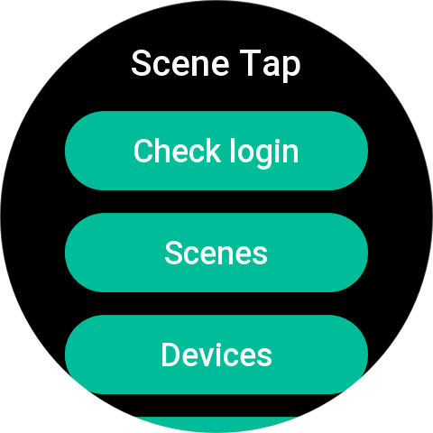
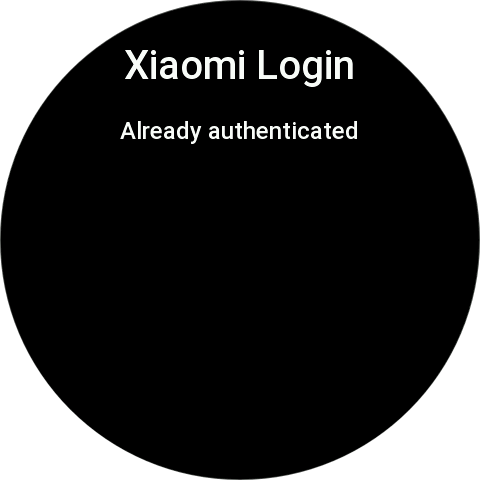
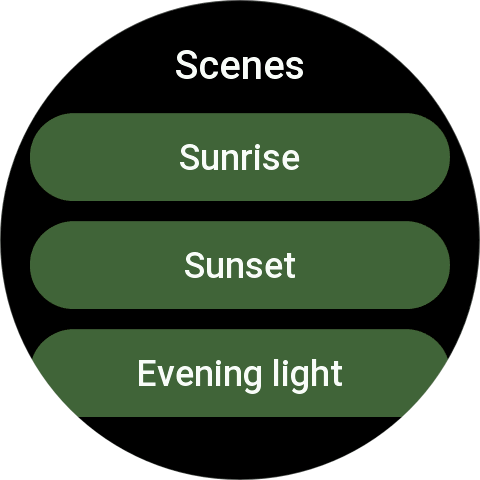
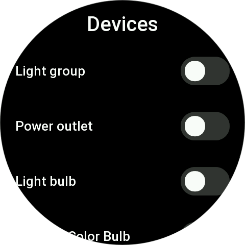
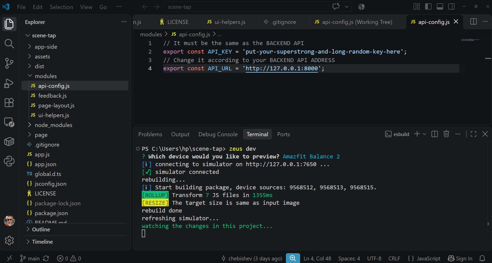

# SceneTap — Zepp OS App

SceneTap is a Zepp OS smartwatch application for controlling Xiaomi Home scenes and smart devices directly from your wrist.

The app communicates with a separate [SceneTap API backend](https://github.com/chebishev/scenetap-api), which handles communication with Xiaomi Home.

## Features

- **Devices** — view available smart devices and control their states using on-screen switches.
- **Scenes** — retrieve available Xiaomi Home scenes and execute them directly from the watch.
- **Xiaomi Home Login** — initiate QR-code login and check the authentication status.
- **Network error handling** — retry failed GET requests and display an error message if the request ultimately fails.
- **Haptic feedback** — vibrate the watch when certain requests fail.
- **Screen timeout adjustment** — keep the screen active longer while using pages that need additional time to load.

## Architecture

SceneTap consists of two separate components:

- **Zepp OS app** — the smartwatch interface, user interaction, and communication with the backend.
- **SceneTap API** — a [separate API service](https://github.com/chebishev/scenetap-api) responsible for Xiaomi Home integration and device/scene operations.

The watch communicates with the API over HTTP. API authentication is handled using an API key configured in the app.

## Requirements

- A compatible Amazfit smartwatch running Zepp OS (API LEVEL 4.0+).
- A running SceneTap API backend.
- Network connectivity between the watch and the API server.
- A configured API URL and API key.

The current implementation targets API 4.0-compatible devices. Compatibility with API 3.0 devices has not been established; some UI components and layout APIs may require adaptation.

## Configuration

Configure the API connection in the app's API configuration module:

`modules/api-config.js`

Set the API URL and API key according to your backend configuration.

Do not commit real API keys or other secrets to a public repository.

## Application Structure

The following describes the main modules currently used by the app:

- `page/index.js` — main menu and navigation.
- `page/devices.js` — device list and device-state controls.
- `page/scenes.js` — scene list and scene execution.
- `page/login.js` — QR-code login and authentication status.
- `modules/api-config.js` — backend connection configuration.
- `modules/ui-helpers.js` — shared UI configuration and layout helpers.
- `modules/feedback.js` — shared haptic feedback functionality.

The app also contains the Zepp OS side-service implementation that maps app requests to backend HTTP endpoints.

## API Operations

The Zepp OS app sends the following operations through its side service:

| Operation | Backend endpoint | Method |
|---|---|---|
| `START_QR_LOGIN` | `/login/qr` | POST |
| `GET_LOGIN_STATUS` | `/login/status` | GET |
| `GET_DATA` / `GET_DEVICES` | `/devices` | GET |
| `GET_SCENES` | `/scenes` | GET |
| `RUN_SCENE` | `/scenes/{scene_id}/run` | POST |
| `SET_DEVICE_STATE` | `/devices/{did}/state` | POST |

The exact backend behavior depends on the deployed SceneTap API implementation.

## Error Handling

GET requests are retried up to three attempts when a network exception occurs, with a short delay between attempts.

POST requests are not automatically retried because a command may already have been executed by the backend even if the response is lost.

When a request fails, the app can display an error message and provide haptic feedback.

## Development Notes

- The Zepp OS app and the API backend are maintained separately.
- Keep backend operations and UI rendering independent where possible.
- Test device controls and scene execution on a real watch.
- UI compatibility should be verified on each target Zepp OS API level and screen size.
- Do not assume that a successful HTTP response guarantees that a physical device has reached its requested state.

## License

[MIT](LICENSE)

## Screenshots

